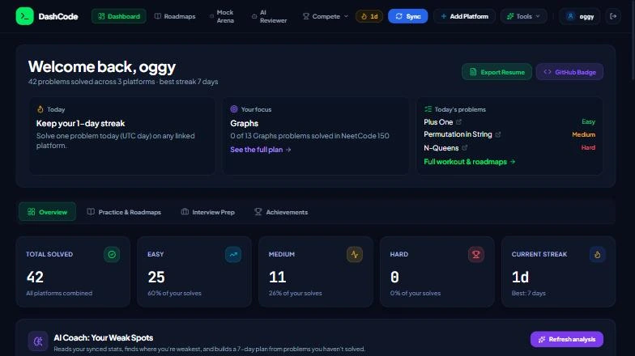

# 🚀 DashCode: Coding Progress Dashboard

A full-stack competitive programming and interview-prep dashboard. Track your **Codeforces**, **LeetCode** and **CodeChef** progress in one place, practise timed mock interviews with a real code runner, and get AI code reviews and coaching.

**Live:** [coding-dashboard-two.vercel.app](https://coding-dashboard-two.vercel.app)



---

## ✨ Features

- 📊 **Combined Multi-Platform Metrics**: Total solved problems and Easy/Medium/Hard breakdown across Codeforces, LeetCode and CodeChef.
- 🧭 **Today Panel**: Streak status, your AI coach's current focus and today's top 3 problems at the top of the dashboard.
- 🧠 **AI Coach**: Google Gemini finds your weakest topics and habits from your real synced stats and builds a 7-day plan. It may only recommend unsolved NeetCode 150 problems (checked on the server, so no invented problems or links). Falls back to a clearly labelled rule-based estimate if the AI is unavailable.
- 🤖 **AI Solution Reviewer**: Gemini reviews your code for Big-O time and space complexity, bugs and bottlenecks, suggests an improved solution and gives 3 realistic interviewer follow-up questions.
- ⏱️ **45-Minute Mock Interview Simulator**: Timed rounds for Google, Amazon, Meta and Microsoft with sourced questions, a progressive hint ladder, a **real test runner** (Python and TypeScript run in your browser via Pyodide/Sucrase; C++ and Java run on Judge0) and a final scorecard.
- 👥 **Private Clans**: Create a clan, share an invite code and chase a weekly problem goal together, with a member leaderboard and a feed of recent solves.
- 📄 **1-Click ATS Resume Sheet**: Print/PDF export with your verified stats, contest ratings, topic strengths and a live profile link.
- 🎮 **RPG Level & Skill Tree**: Player levels, XP, rarity badges and a 4-branch skill tree.
- 🔥 **Daily Workout & Streak Protection**: A daily 3-problem set (warm-up, core, boss) aimed at your growth areas.
- 📚 **Curated Sheets**: Blind 75, NeetCode 150 and Striver SDE Sheet with automatic solve detection.
- 🏢 **Company Readiness**: Interview readiness % for Google, Amazon, Meta, Microsoft and Uber based on company topic weights.
- 🛡️ **GitHub README Badge**: Live SVG stats card at `/api/badge/<username>` with copyable Markdown.
- 🖼️ **Link Previews**: Generated Open Graph images for the home page and every public profile.
- ⏳ **Upcoming Contests**: Codeforces, LeetCode and CodeChef schedules with live countdowns and 1-click Google Calendar reminders.
- 🏆 **Global Leaderboard & 1v1 Compare**: Rankings by solved count, streak or rating (`/leaderboard`) and head-to-head comparisons (`/compare`).
- 📅 **Heatmap, Rating & Progress Charts**: 365-day activity heatmap, contest rating timeline and solved-over-time chart.
- 🔁 **Revision Queue**: Spaced-repetition picks of problems you solved 1 week to 4 months ago.
- 🪪 **Public Profiles**: Shareable `/u/<username>` page with bio, status and GitHub/LinkedIn links.
- 🔄 **Real-Time & Scheduled Sync**: A **Sync** button, auto-sync when your data is over 30 minutes old, an hourly background sync of every user (GitHub Actions) and an optional LeetCode browser extension that syncs on every Accepted submission.
- 🔐 **Privacy & Account Control**: Privacy Policy and Terms pages, self-service account deletion and daily per-user limits on shared free services.

---

## 🛠️ Tech Stack

| Layer | Tools |
| --- | --- |
| **Backend runtime** | **Node.js** (20.9+). Runs every API route, server-rendered page and background sync, locally and on Vercel |
| **Framework** | Next.js 16 (App Router, Route Handlers, `proxy.ts`), React 19, TypeScript |
| **Styling & UI** | Tailwind CSS v4, Recharts, Lucide React, `next/og` for link-preview images |
| **Database** | Supabase Postgres with Row Level Security; all table access goes through the server (service role) |
| **Auth** | Supabase Auth (email + password) via `@supabase/ssr` cookies |
| **AI** | Google Gemini API (`lib/gemini.ts`: hedged requests across Flash / Flash-Lite models, structured JSON output) |
| **Code execution** | Pyodide + Sucrase in a browser Web Worker (Python, TypeScript); Judge0 CE (C++, Java) |
| **Data sources** | Codeforces API, LeetCode GraphQL, CodeChef profile pages and contest API |
| **Scheduling** | GitHub Actions hourly cron; optional Supabase `pg_cron` + `pg_net` |
| **Monitoring** | Sentry (`@sentry/nextjs`, no personal data sent) |
| **Hosting** | Vercel (Tokyo region, `hnd1`) |
| **Extension** | Chrome Manifest V3 LeetCode auto-sync (`extension/`) |

---

## ⚙️ How the Backend Works (Node.js)

There is no separate Express server: **Next.js runs on Node.js**, so all server code in `app/` and `lib/` executes in Node.

- **API routes** (`app/api/**`): sync, account linking, profiles, clans, account deletion, AI review, AI coach and the code runner. Each request checks the login cookie and reaches Supabase with the server-only service-role key.
- **Server-rendered pages**: `/dashboard`, `/leaderboard`, `/u/<username>` and others read the database and compute stats and streaks in Node before sending HTML.
- **External calls**: Node fetches data from Codeforces, LeetCode and CodeChef, calls Google Gemini and sends C++/Java code to Judge0 (base64-encoded with Node's `Buffer`).
- **Background work and caching**: `after()` runs syncs after the response is sent; short-lived in-memory caches and cooldowns live in the Node process.
- **Generated assets**: SVG README badges and Open Graph link-preview images.
- **Tooling**: `npm run dev`, `npm run build`, ESLint and the maintenance scripts in `scripts/`.

Python and TypeScript mock-interview code, charts and UI interactions run in the browser instead.

---

## 🚀 Quickstart & Local Setup

### Prerequisites
- **Node.js 20.9 or newer** (required by Next.js 16) and npm
- A free [Supabase](https://supabase.com) project

### 1. Clone & Install
```bash
git clone https://github.com/Tarun18-bit/coding_dashboard.git
cd coding_dashboard
npm install
```

### 2. Database Setup (Supabase)
1. Create a free project at [supabase.com](https://supabase.com).
2. Open the **SQL Editor** in your Supabase dashboard.
3. Run these files in order (each is safe to run more than once):
   1. [`supabase/schema.sql`](supabase/schema.sql): core tables
   2. [`supabase/migrations/002_clans_profiles.sql`](supabase/migrations/002_clans_profiles.sql): clans, profile fields, snapshot cleanup, indexes
   3. [`supabase/migrations/003_usage_limits.sql`](supabase/migrations/003_usage_limits.sql): daily per-user limits (25 AI reviews, 6 AI coach reports, 40 C++/Java runs, 20 account links)
   4. [`supabase/migrations/004_hardening.sql`](supabase/migrations/004_hardening.sql): RLS on every table, revokes public-role access, scheduler extensions

### 3. Configure Environment Variables
```bash
cp .env.example .env.local
```

Then fill in `.env.local`:

| Variable | Required | What it's for |
| --- | --- | --- |
| `NEXT_PUBLIC_SUPABASE_URL` | Yes | Your Supabase project URL |
| `NEXT_PUBLIC_SUPABASE_ANON_KEY` | Yes | Supabase anon key (used for login only) |
| `SUPABASE_SERVICE_ROLE_KEY` | Yes | Server-only key for database access. **Never expose it to the browser or commit it.** |
| `SYNC_SECRET_TOKEN` | Yes | Long random string the hourly sync job sends as a Bearer token |
| `GEMINI_API_KEY` | For AI features | Free key from [aistudio.google.com/apikey](https://aistudio.google.com/apikey) |
| `GEMINI_MODEL` | No | Pin a specific primary Gemini model |
| `NEXT_PUBLIC_APP_URL` | No | Public URL used for badges, share links and SEO |
| `JUDGE0_API_KEY` | No | RapidAPI Judge0 key. Leave unset to use the free public `ce.judge0.com` |
| `JUDGE0_API_HOST` / `JUDGE0_URL` | No | Override the Judge0 host |
| `NEXT_PUBLIC_SENTRY_DSN` | No | Your own Sentry project (errors are only reported in production) |
| `DEFAULT_CODEFORCES_HANDLE` / `DEFAULT_LEETCODE_USERNAME` | No | Handles used by the local debug scripts and dev-only `/api/test/*` routes |

> [!CAUTION]
> `.env.local` is git-ignored. Keep every real key in it (and in Vercel's Environment Variables), never in source files.

### 4. Run the Development Server
```bash
npm run dev
```
Open [http://localhost:3000](http://localhost:3000), create an account and link a platform.

---

## 🔌 How to Add a New Platform (e.g. AtCoder, GFG)

All platforms implement the `PlatformFetcher` interface in [`lib/platforms/types.ts`](lib/platforms/types.ts):

```typescript
export interface PlatformFetcher {
  platformName: string;
  fetchProfile(handle: string): Promise<Snapshot>;
  fetchContests(handle: string): Promise<Contest[]>;
  fetchRecentSubmissions(handle: string, limit?: number): Promise<Submission[]>;
}
```

1. **Create the fetcher**: add `lib/platforms/myplatform.ts` implementing `PlatformFetcher` (see [`codeforces.ts`](lib/platforms/codeforces.ts) or [`codechef.ts`](lib/platforms/codechef.ts)). A GeeksforGeeks template already exists in [`gfg.ts`](lib/platforms/gfg.ts).
2. **Register it in both places**:
   - `getFetcher()` in [`lib/sync.ts`](lib/sync.ts) (hourly and manual sync)
   - `getFetcher()` in [`app/api/accounts/route.ts`](app/api/accounts/route.ts) (linking a handle)
3. **Add it to the Add Platform modal** in [`components/AccountModal.tsx`](components/AccountModal.tsx).

The dashboard then aggregates solve counts, rating history, heatmap and submissions for the new platform automatically.

---

## ⚡ Automated Hourly Sync with GitHub Actions

The workflow in [`.github/workflows/sync.yml`](.github/workflows/sync.yml) calls `/api/sync` every hour.

1. Go to your GitHub repository → **Settings** → **Secrets and variables** → **Actions**.
2. Add these repository secrets:
   - `APP_URL`: your deployed URL (e.g. `https://your-dashboard.vercel.app`)
   - `SYNC_SECRET_TOKEN`: the same value as your `SYNC_SECRET_TOKEN` environment variable

The endpoint answers immediately, then refreshes every user's accounts in the background (most out-of-date first, within Vercel's 60-second limit). If `SYNC_SECRET_TOKEN` is not set on the server, token access is disabled (fails closed).

> [!TIP]
> GitHub sometimes skips scheduled runs. Step 5 of `004_hardening.sql` shows how to add a backup hourly job inside Supabase with `pg_cron`, storing the token in Supabase Vault.

---

## 🧩 LeetCode Auto-Sync Extension (optional)

The [`extension/`](extension/) folder is a Chrome extension that triggers a sync whenever you get an Accepted submission on LeetCode. Load it via `chrome://extensions` → **Developer mode** → **Load unpacked**, then set your dashboard URL in its popup. See [`extension/README.md`](extension/README.md).

---

## 🌐 Deploying to Vercel

1. Push your code to GitHub.
2. On [vercel.com](https://vercel.com), click **Add New Project** and import the repository.
3. Under **Environment Variables**, add at least `NEXT_PUBLIC_SUPABASE_URL`, `NEXT_PUBLIC_SUPABASE_ANON_KEY`, `SUPABASE_SERVICE_ROLE_KEY`, `SYNC_SECRET_TOKEN` and `GEMINI_API_KEY` (plus any optional ones from the table above).
4. Click **Deploy**.

---

## 🔒 Security Notes

- Every table has Row Level Security, and public roles have no table access; the browser only uses Supabase for login.
- Secrets are only read on the server from environment variables; none are stored in the repository.
- AI, code-runner and account-link routes require login and have daily per-user limits.
- Security headers (HSTS, `X-Frame-Options: DENY`, `nosniff`, Referrer and Permissions policies) are set in [`next.config.ts`](next.config.ts).
- Found a security issue? Please open an issue on [GitHub](https://github.com/Tarun18-bit/coding_dashboard/issues).
